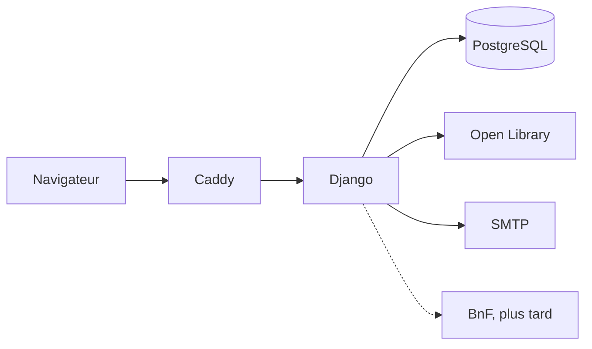
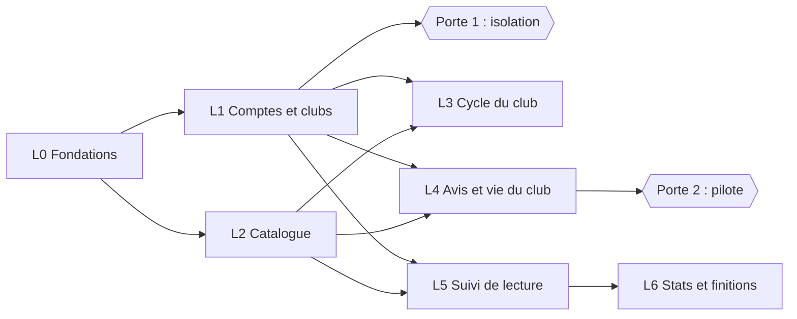

# Plan de développement — outil de club de lecture privé

Mis à jour le 18 novembre 2026. Source : arbitrage des priorités de MC (voir `ANALYSE.md`).

## Contexte et périmètre

Un outil pour animer **un** club de lecture privé : quelques dizaines de lecteurs, aucune diffusion publique. Le code est public sur GitHub, l'application n'est pas proposée comme service.

- **Principe directeur** : reprendre de Letterboxd son geste de base (noter, relire, lister, commenter) et y ajouter ce qui fait un club : le choix du livre et la discussion.
- **Hors périmètre** : pages publiques, découverte ouverte, partage externe, flux RSS, annuaire public, comptes d'éditeurs, journal éditorial, offre premium, application mobile native.
- **À discuter plus tard** : API publique. Le mobile passera par un habillage du site optimisé mobile, pas par une application.
- **Licence** : GPL, dépôt public sur GitHub.
- **Langue** : français uniquement, avec tutoiement ; tous les textes de l'interface sont externalisés pour permettre une traduction plus tard.

## Règles produit

1. **Tout est privé.** Rien n'est lisible sans compte, ni en dehors d'un club.
2. **Visibilité par clubs communs.** Un membre voit le profil, les lectures, les avis et les listes d'un autre membre si et seulement s'ils partagent au moins un club. Une seule règle, appliquée dans les requêtes de données, jamais seulement dans les écrans.
3. **Un club au départ, plusieurs possibles.** Le modèle autorise dès le début plusieurs adhésions par utilisateur. L'interface multi-clubs vient en P2.
4. **Adhésion par lien.** L'animateur partage un lien d'invitation et le suivre suffit pour rejoindre. L'animateur peut renouveler le lien (l'ancien cesse de fonctionner) et exclure un membre.
5. **Discussion par commentaires.** On commente les avis et on peut répondre à un commentaire existant. Un avis justifie une note : on note d'abord, l'avis vient l'expliquer, jamais l'inverse. Pas de fils par chapitre dans le MVP.

L'inscription propose d'emblée deux chemins : **créer mon club** ou **rejoindre un club** avec un lien.

## Stack et architecture

Une seule application Django rendue côté serveur, avec PostgreSQL : le choix le plus simple à maintenir pour un club de quelques dizaines de personnes.

| Couche | Choix | Pourquoi |
|---|---|---|
| Langage et framework | Python, Django | authentification, administration, migrations et traduction fournies |
| Interface | Gabarits Django, HTMX, Tailwind CSS | peu de JavaScript, pages rapides, affichage adaptatif |
| Langue | Français (tutoiement), textes externalisés (gettext) | traduction possible plus tard sans refonte |
| Base de données | PostgreSQL | contraintes d'intégrité, recherche plein texte intégrée |
| Comptes | django-allauth (e-mail et mot de passe) | inscription, confirmation et réinitialisation éprouvées |
| Catalogue | API Open Library, copie locale des fiches | sans clé, pas de dépendance à l'affichage |
| E-mail | SMTP configurable | invitations, alertes, réinitialisations |
| Tests et CI | pytest-django, GitHub Actions, ruff | contrôle à chaque commit |
| Déploiement | Docker Compose, Caddy, serveur personnel sous Linux | aucun coût d'hébergement, HTTPS automatique ; accès depuis Internet à définir |

### Catalogue : mise à jour des livres

Pas de base complète à entretenir : l'application garde une copie locale des seuls livres utilisés par les clubs.

- **Ajout** : un livre est copié depuis l'API Open Library au moment où quelqu'un l'ajoute. Les dumps mensuels ne sont pas importés.
- **Recherche** : elle interroge toujours l'API en direct, donc les nouveautés n'exigent aucune synchronisation.
- **Actualisation** : bouton « Actualiser la fiche » pour l'animateur ; pas de mise à jour automatique au départ. Un job mensuel sur les fiches en cours reste possible au lot 6.
- **Corrections manuelles** : un champ corrigé à la main n'est jamais écrasé par une actualisation.
- **Panne de l'API** : les livres déjà copiés restent affichés ; seule la recherche de nouveaux livres échoue, la saisie manuelle prend le relais.

## Modèle de données

Quinze entités suffisent, et le multi-club passe par une table d'adhésion plutôt que par une colonne sur l'utilisateur.

| Entité | Contenu | Règle clé |
|---|---|---|
| Utilisateur | e-mail, nom affiché, bio, avatar | profil global, visible par les clubs communs |
| Club | nom, description, jeton d'invitation | créé par un animateur |
| Adhésion | utilisateur, club, rôle (animateur ou membre), date | unique par couple ; un club garde toujours un animateur |
| Livre | source, ISBN, titre, auteurs, pages, couverture, données d'origine, date de récupération | copie locale ; correction manuelle possible |
| Lecture | utilisateur, livre, statut (à lire, en cours, lu, abandonné), note en demi-points, dates | plusieurs lectures du même livre = relectures ; sert de journal |
| Avis | auteur, lecture (donc livre et note), texte, drapeau spoiler, date | la note est portée par la lecture ; l'avis la justifie et n'existe pas sans elle |
| Commentaire | avis, commentaire parent (facultatif), auteur, texte | les réponses s'imbriquent via le parent |
| Liste | propriétaire, titre, description | visible par les clubs communs |
| Élément de liste | liste, livre, rang, note libre | un livre une fois par liste |
| Proposition | club, livre, proposé par | alimente un vote |
| Vote | club, propositions, ouverture, clôture | un seul vote ouvert par club |
| Bulletin | utilisateur, vote, proposition choisie | un bulletin par personne et par vote |
| Sélection | club, livre, début, fin, statut (en cours ou passée) | le livre du mois |
| Notification | destinataire, type, objet, date de lecture | affichage dans l'appli et par e-mail |
| Évènement d'activité | acteur, type, objet, date | le flux montre les évènements des membres de mes clubs |

Une seule fonction, « partage-t-il un club avec moi ? », filtre toutes les requêtes sur les lectures, avis, commentaires, listes et évènements. Elle est testée avant toute autre chose.

## Lots de développement

Sept lots, deux portes : l'isolation entre clubs (après le lot 1), puis la mise en service pilote (après le lot 4). Le club passe avant le suivi personnel, parce que choisir un livre et en discuter est la valeur propre de l'outil. Les lots 1 et 2 peuvent avancer en parallèle.

| Lot | Contenu (numéros de l'inventaire) | Dépend de | Terminé quand |
|---|---|---|---|
| L0 Fondations | dépôt public, licence, CI, Docker Compose, squelette Django, textes externalisés (47) | rien | `docker compose up` lance l'appli et la CI est verte |
| L1 Comptes et clubs | inscription, profil, réglages, création de club, lien d'adhésion, rôles, modération, suppression de compte (6, 8, 9, 29, 45, 46, 48) | L0 | deux clubs sont étanches, prouvé par des tests |
| L2 Catalogue | client Open Library, copie locale, fiche livre, recherche, saisie manuelle, actualisation d'une fiche (1, 3, 4) | L0 | un livre est cherché, ajouté et affiché sans appel externe |
| L3 Cycle du club | propositions, vote, livre du mois, calendrier (30) | L1, L2 | un cycle complet va de la proposition à la clôture |
| L4 Avis et vie du club | avis, spoilers, commentaires avec réponses, flux du club, notifications de base (18, 19, 21, 22) | L1, L2 | le club peut choisir, lire et discuter |
| L5 Suivi de lecture | statuts, journal daté, notes, listes, filtres et tris (11, 12, 13, 17, 25) | L1, L2 | chaque membre tient son carnet de lecture |
| L6 Stats et finitions | stats et bilan, accessibilité, copy complet, durcissement, sauvegardes (37, 43, 44) | L5 | la version 1.0 est ouverte à tous les membres |

## Sécurité et vie privée

Le dépôt est public, les données ne le sont pas : aucun secret ni aucune donnée de membre ne doit jamais entrer dans Git.

- **Configuration** par variables d'environnement ; un fichier d'exemple sans aucune valeur réelle ; un contrôle de secrets à chaque pull request.
- **Lien d'invitation** : jeton aléatoire long, renouvelable, révocable par l'animateur.
- **Isolation entre clubs** : un test automatique échoue si un membre d'un club peut lire une donnée d'un autre club.
- **Comptes** : mots de passe hachés (réglage par défaut de Django), limitation des tentatives de connexion, double authentification en P2.
- **Données personnelles** : le strict nécessaire (e-mail, nom affiché), suppression de compte dès le MVP, export des données en P2.
- **Appels externes** : l'API du catalogue ne reçoit jamais de données de membres. Les conditions d'usage (identification de l'application, limites de requêtes) sont à vérifier dans la documentation d'Open Library avant le lot catalogue.
- **Sauvegardes** : sauvegarde chiffrée de la base, avec une restauration testée une fois avant la mise en service.
- **Dépendances** : alertes automatiques de mises à jour de sécurité.

## Qualité, tests et déploiement

Chaque lot se termine par des tests verts en CI et un déploiement reproductible.

- **Tests** : priorité à l'isolation entre clubs, au cycle de vote et à l'import Open Library (réponses simulées, aucun appel réel en test).
- **CI** (GitHub Actions) : analyse de style, tests, contrôle de secrets et audit des dépendances à chaque pull request.
- **Déploiement** : Docker Compose (application, PostgreSQL, Caddy) sur le serveur personnel ; migrations appliquées au démarrage ; sauvegarde nocturne de PostgreSQL vers un stockage externe.
- **Environnements** : local et production. Pas de préproduction au début.
- **Accessibilité** : contrôle du clavier et des contrastes à chaque lot, audit complet au dernier lot.
- **Documentation** : README d'installation et guide de l'animateur en une page.

### Serveur personnel (en cours de mise en place)

Machine prévue : HP ProBook 470 G2 (Core i7-4510U, 8 Go de RAM, disque de 230 Go), à réinstaller sous Linux (Debian stable ou Ubuntu Server LTS, sans interface graphique).

- Vérifier le type de disque (SSD ou plateau) et son état (`smartctl -a`).
- Chiffrer le disque ; accepter la saisie de la phrase de passe après une coupure.
- Désactiver la mise en veille à la fermeture du capot ; redémarrage automatique au retour du courant (BIOS).
- Retirer ou limiter la charge de la batterie si elle est usée ; dépoussiérer et ventiler.
- SSH par clé uniquement ; mises à jour de sécurité automatiques.
- Accès depuis Internet : préférer un tunnel (aucun port ouvert sur la box), à confirmer.

## Risques

Le catalogue est le risque principal ; l'isolation entre clubs est le plus grave.

| Risque | Effet | Parade |
|---|---|---|
| Données Open Library inégales (base éditable par la communauté) | doublons, couvertures absentes, nombre de pages faux | correction manuelle par l'animateur, saisie manuelle d'un livre, copie locale |
| Limites ou indisponibilité de l'API | recherche de livres en panne | copie locale des fiches, message clair, vérification des limites avant le lot catalogue |
| BnF : changement de format et de modèle de catalogage en juin 2026 | données diffusées perturbées | BnF seulement en P2, derrière une interface commune de source de catalogue ; à tester avant de s'engager (non vérifié à ce jour) |
| Fuite de données entre clubs | un membre voit les données d'un autre club | filtre central et tests dédiés (porte 1) |
| Dérive vers un réseau social public | complexité inutile | liste des éléments hors périmètre en début de document |
| Panne du serveur personnel (courant, box, matériel, disque) | site indisponible, perte de données | sauvegarde nocturne chiffrée hors du serveur, restauration testée, coupures annoncées aux membres |
| Machine domestique exposée à Internet | intrusion, accès au réseau local | si possible aucun port ouvert sur la box (tunnel), système et dépendances à jour, disque chiffré, SSH par clé |

## Décisions

**Tranchées** : tout est privé ; un seul club au départ (modèle multi-clubs prêt) ; adhésion par lien ; discussion par commentaires avec réponses ; français en tutoiement avec textes prêts à traduire ; Django et PostgreSQL ; serveur personnel (en cours de mise en place) ; licence GPL ; un avis justifie une note et n'existe pas sans elle ; web uniquement, sans application mobile (41) ni offre premium (42).

**Ouverte** : API publique (point 40), à discuter.
